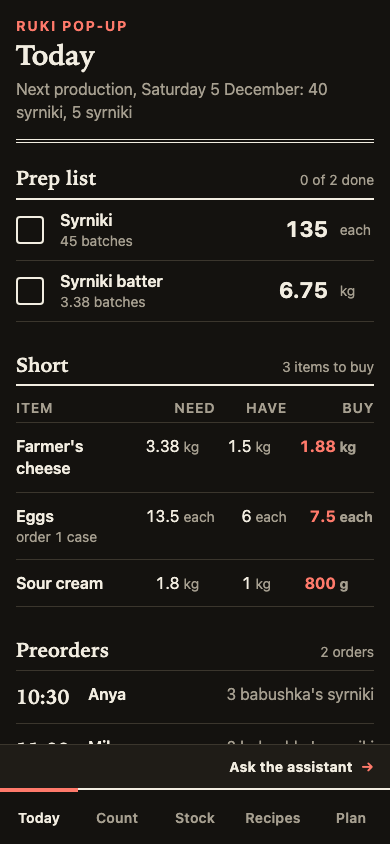
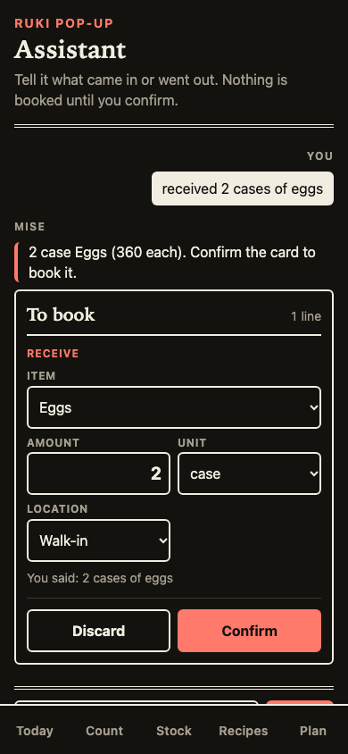
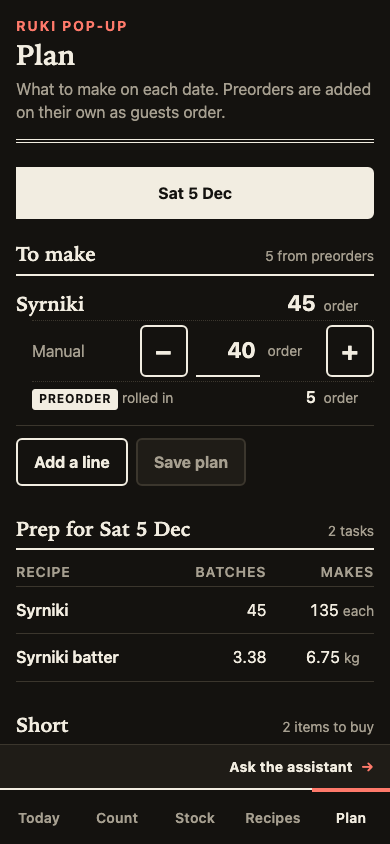
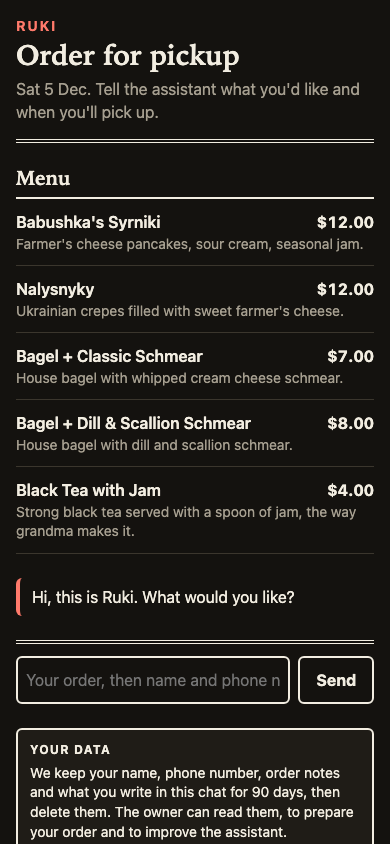

# Mise

Mise is a kitchen tool for a small pop-up. It keeps track of what's in the walk-in, works out what to prep and buy for a production day, and lets guests preorder from a chat page. An assistant takes stock changes typed in plain words ("received 2 cases of eggs"), but it never books anything itself. It makes a card, and I confirm it.

I built it for Ruki, a Ukrainian-Russian brunch pop-up. I cooked in restaurants for years before I became a software engineer, and the work that eats a chef's week isn't taking orders. It's counting, prepping the right amount and ordering enough eggs. Mise is *mise en place* for that: everything in its place before service.

It's for one kitchen with one owner. Deliberately small: one Express process, JSON files for storage, a React app on top. [Scaling](docs/design/scaling.md) says what changes beyond that.

<p>
  
  
  
</p>

## The screens

- **Today.** The next production date: the prep list, what's short to buy (eggs in cases), and the guest preorders for that day, first names only.
- **Count.** Walk a shelf, change only what's different, save. A double tap saves once.
- **Stock.** What's on hand by location, with flags for negative, expired and below par, and each item's history. Stock is an event log, so a mistake is fixed by a new count, not an edit.
- **Recipes and Plan.** Recipes with their cost per batch and per plate. Plans that explode into prep tasks and a shopping list, with preorders rolled in as lines I can't edit.
- **Assistant.** I type what happened. It looks things up, and for stock changes it proposes a card. If stock changed under a card, the card goes stale until I refresh it. If it meets a name it doesn't know, it offers to add the item.
- **`/order`.** The guest page, in English or Russian. Pickup windows have spots, a batch of syrniki sells out, and orders close at the cutoff. Those rules are code, not prompt.

<p>
  
</p>

The rest is in [features](docs/features.md).

## Run it

```bash
npm install
npm --prefix web install
cp .env.example .env
npm run web:build
npm start                   # http://localhost:3000
```

Set `MISE_OWNER_PASSCODE` in `.env` first, at least 8 characters. That's the passcode for the kitchen screens, and without it sign-in answers 503. The guest page at `/order` doesn't need it.

With no `ANTHROPIC_API_KEY`, Mise runs on an offline mock model, so you can click through everything for free. The mock only knows the scripted cases, so for real conversations put a key in `.env` and Mise uses Claude (`MISE_LLM=mock` forces the mock). Claude calls cost money. `MISE_DAILY_BUDGET_USD` caps what the guest chat and the assistant spend together in a day.

Set `DATA_DIR` (the example file points it at `./data/runtime`) so stock and orders survive a restart. Without it they're kept in memory.

Other commands:

```bash
npm test                      # unit tests, and every scripted eval scenario on the offline mock
npm run typecheck
npm run web:test              # the screens' tests
npm run eval -- --llm mock    # the evals, offline and free
npm run e2e                   # browser smoke tests (needs: npx playwright install chromium)
npm run demo                  # records the screenshots in docs/demo/
npm run loadtest -- 300 50    # 300 guests, 50 at a time, against the real server
```

`npm run eval` without `--llm mock` calls Claude and costs money. Give it a cap with `--max-usd`. How the evals and the other tests work is in [testing](docs/testing.md).

To run a real pop-up, edit `data/restaurants/ruki.json` (menu, batch sizes, pickup windows, cutoff). `render.yaml` deploys it with a disk for the data. Orders can also go to a Google Sheet or another CRM: see [the Google Sheets setup](docs/google-sheets.md).

## The docs

- [Architecture](docs/architecture.md): the modules and how data moves between them.
- [Features](docs/features.md): each screen, how to use it, where it lives and what tests it.
- [Testing](docs/testing.md): unit tests, browser tests, evals, pass^k, and the bugs the tests found.
- [Glossary](docs/glossary.md): par, netting, yield, proposal, stale.
- [Decisions](docs/decisions/README.md): why it's built this way.
- [Built with agents](docs/agents.md): the agents, what they cost and what the reviews caught.
- [Scaling](docs/design/scaling.md): what changes beyond one kitchen.
- [Security backlog](docs/security-backlog.md): known findings, each with a test.

## About

Built by [Yuri Belorusets](https://www.linkedin.com/in/yuribelorusets), a software engineer and former cook, with Claude Code.

MIT License.
