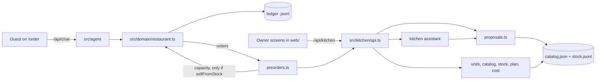

# Architecture

Mise is one Express process with two audiences. Guests chat to preorder food for the pop-up. I use the kitchen screens to count stock, plan prep and confirm what the assistant suggests. Both sides run in the same server, `src/server.ts`, and share one list of orders.

## The guest side

A guest opens `/order`, the page in `web/src/pages/Order.tsx`, and chats. Each message goes to `POST /api/chat` in `src/server.ts`. It keeps one session per `sessionId`, runs one turn at a time per session, and applies the per-IP rate limit, the turn limit and the daily budget from `src/ops/guardrails.ts`.

The turn itself is `runTurn` in `src/agent/agent.ts`. The model gets four tools from `src/agent/tools.ts`: `search_menu`, `list_pickup_windows`, `place_order` and `handoff_to_human`. The prompt is in `src/agent/prompt.ts`. Every rule that matters (stock, pickup windows, the cutoff, duplicate orders, date checks) is enforced in `src/agent/tools.ts` and `src/domain/restaurant.ts`, not in the prompt. See [decision 2](decisions/0002-rules-live-in-code.md). Quantities are always orders, not pieces: [decision 9](decisions/0009-quantities-are-orders.md).

`RestaurantStore` in `src/domain/restaurant.ts` holds the menu, the orders and the limits. `remaining()` takes the lowest of two limits: the menu item's own `quantity` minus what's sold, and, only when `popup.sellFromStock` is true and the item has `makes`, what the kitchen can make from stock. The stock limit is a `capacity` function that `src/server.ts` passes in as `kitchenCapacity`. If working it out throws (the kitchen item was deleted), the server logs it once and falls back to the menu quantity. See [decision 12](decisions/0012-preorders-and-stock.md).

At startup `checkMakes` in `src/server.ts` refuses to start if a menu item's `makes` names an item that isn't in the catalog, or a unit that item doesn't have.

Orders are appended to the ledger (`src/ops/ledger.ts`), and old ones are redacted after the retention period. The model layer is `src/llm/`: `anthropic.ts` for Claude and `mock.ts` for the offline model. `src/config.ts` picks one, and also owns `now()`, which `MISE_TODAY` freezes.

## The kitchen core

Everything in `src/kitchen/` below is plain functions over a `Catalog` and a list of stock events. The types are in `src/kitchen/types.ts`.

- **Units** (`src/kitchen/units.ts`). Every item has a base unit: `g`, `ml` or `each`. `toBase` converts using the item's own units first (a case of eggs), then a global table (kg, oz, cup, dozen). An unknown unit throws `UnitError`.
- **Catalog** (`src/kitchen/catalog.ts`). Items, locations, recipes and plans. `validateCatalog` rejects duplicate or badly formed ids, units that don't convert, a recipe with no yield, two recipes making the same item, and recipe cycles. Each recipe makes an item ([decision 5](decisions/0005-every-recipe-makes-an-item.md)).
- **Stock** (`src/kitchen/stock.ts`). Stock is an append-only list of events: receive, use, waste, count, move. On-hand is computed from the list each time and never stored ([decision 3](decisions/0003-stock-is-an-event-log.md)). A count sets the amount for one item in one location.
- **Plan explosion** (`src/kitchen/plan.ts`). `explode` takes plan lines and what's on hand. It uses stock first, then makes the rest from recipes, going down through sub-recipes. It returns prep tasks with batch counts and a shopping list. Shopping rounds up to the item's biggest own unit, so eggs come out in cases.
- **Cost and max batch** (`src/kitchen/cost.ts`). `batchCost` prices a batch from the latest price paid on a receive event, and lists items with no price yet. `maxBatch` binary-searches the most whole units you can make from what's available. It returns `Infinity` when stock covers the search limit. The default limit is 10,000, but every caller passes 1,000,000, so a real amount in grams never reads as unlimited. The `/api/kitchen/max-batch` route and the assistant's `max_batch` tool send `Infinity` as `max: null`, and the menu's `remaining()` treats it as no stock limit.

## Storage

The kitchen reads and writes through `KitchenStore` (`src/kitchen/types.ts`). `src/kitchen/file-store.ts` is the real one. `src/kitchen/memory-store.ts` is for tests and for running with no data directory. Why files and one process: [decision 6](decisions/0006-files-and-one-process.md).

With `DATA_DIR` set, these files appear for the `ruki` kitchen:

- `ruki.catalog.json`: the catalog, rewritten through a `.tmp` file and a rename. It starts as a copy of `data/kitchens/ruki.json`.
- `ruki.stock.jsonl`: one stock event per line, appended. A torn last line after a crash is skipped, and a repeated event id is ignored, so a retried write can't count twice.
- `ruki.proposals.json`: the proposals, covered below.
- `ruki.jsonl`: the ledger of guest orders and chat turns, from `src/ops/ledger.ts`.

Without `DATA_DIR`, the server warns that stock isn't saved and keeps everything in memory. The restaurant config (menu, pickup windows, `sellFromStock`) isn't in `DATA_DIR`. It's `data/restaurants/ruki.json`, read at startup.

## The kitchen API and sign-in

`src/kitchen/api.ts` is the router mounted at `/api/kitchen`. It covers the catalog (save one record, delete one), stock and an item's history, counts, Today, plans and a plan's result, cost, max batch, proposals and the assistant. It stays thin: the rules sit in the modules above.

Two details:

- `POST /counts` takes a `clientId` and builds event ids from it, so a double tap on Save writes the count once.
- Plans come from `plansByDate`, which adds preorder lines to the stored plan for the date (the first one, if a date has several), or makes a plan called `preorders-<date>` when only preorders exist. The catalog endpoint refuses a stored plan id that starts with `preorders-` and drops any stored line marked as a preorder, so the two can't be confused.

Sign-in is `src/ops/owner-auth.ts`, wired up in `src/server.ts` ([decision 11](decisions/0011-owner-sign-in.md)). `MISE_OWNER_PASSCODE` is hashed with scrypt at startup. A correct passcode at `POST /api/owner/sign-in` sets an `HttpOnly`, `SameSite=Strict` cookie, and the server keeps only a hash of the token in memory. Sessions last 30 days and end on restart. Failed attempts are limited per IP and overall. With no passcode set, sign-in answers 503. `requireOwner` guards all of `/api/kitchen`.

`src/ops/request-guards.ts` runs on every request before the routes. `jsonOnly` rejects `/api/` writes that aren't JSON with 415. `sameOrigin` rejects browser writes from another site with 403, using `Sec-Fetch-Site` and then `Origin`. Extra allowed origins go in `MISE_ALLOWED_ORIGINS`.

## Proposals

Anything the model suggests is a proposal, and nothing reaches stock until I confirm it ([decision 4](decisions/0004-model-output-is-a-proposal.md)). The code is `ProposalBook` in `src/kitchen/proposals.ts`.

- `create` checks every line with `checkLine` (the item exists, the kind is one of the five, the location exists, a move goes somewhere else, the unit converts). It records `basedOn`, the length of the event log at that moment.
- `confirm` checks again, then appends one stock event per line, with the id `<proposal id>-<n>`. I can edit the lines when I confirm. Confirming twice returns the first result. If a confirm wrote its events and then died, the next confirm finds them and finishes.
- `discard` closes an open proposal. A confirmed one can't be discarded.
- **Stale.** A proposal is stale when an event after `basedOn`, not written by this proposal, is for one of its items (or one of the items in my edited lines). Confirming a stale proposal fails with 409. `refresh` moves `basedOn` to the current end of the log, and then I can confirm. An event for an unrelated item doesn't make it stale.
- Proposals are saved to `<id>.proposals.json`. Confirmed and discarded ones are dropped after 30 days.

`src/kitchen/api.ts` calls `confirm` with no `await` in between, so two requests at once can't both book.

## The kitchen assistant

`src/kitchen/assistant/` is the owner's chat. `index.ts` creates it, with one lock per session. `loop.ts` runs a bounded turn: a capped number of model calls and tool calls, and history trimmed to the most recent messages. The session history changes only when a turn finishes, so a failed model call leaves it as it was. If the model can't be reached, the reply says so and points me to the count screen.

Its tools are in `src/kitchen/assistant/tools.ts`. Six only read or check: `find_item`, `on_hand`, `shopping_list`, `prep_list`, `max_batch` and `cost`. Two produce something for me to decide: `propose_stock_changes` makes a proposal, and `offer_new_item` offers to add an item that isn't in the catalog. The assistant proposes stock changes only. It can't edit plans, recipes or the catalog, and nothing it does is booked until I confirm the card.

With the mock model, `index.ts` swaps in `KitchenMockLLM` (`src/kitchen/assistant/mock.ts`), because the guest mock only knows the menu. Assistant turns are logged to the same ledger as guest turns, with channel `kitchen`. They count against the same daily budget and have their own per-minute limit.

## Preorders feed the plan

`src/kitchen/preorders.ts` turns orders into plan lines. `preorderLines` sums what was ordered for a pickup date, for each menu item that has `makes`, in the kitchen item and unit. They're computed from the orders each time and never stored. `planLines` puts the plan's own lines first, then those. If two guests order syrniki for the same date, the plan for that day has their total, and `explode` works out what that needs.

`orderCapacity` goes the other way. It sets aside what the day's plan already uses, then asks `maxBatch` how many more of the item the rest of the stock makes. It only matters when `sellFromStock` is on.

## The web app

`web/` is a React and Vite app ([decision 7](decisions/0007-react-and-vite.md)). In `web/src/`:

- `App.tsx` has the routes. `RequireOwner` shows `SignIn` until `/api/owner/me` says I'm signed in. `/order` is outside it, because guests don't sign in.
- `pages/` has one file per screen: Today, Count, Stock, Recipes, Plan, Assistant, Order and SignIn.
- `api/` has the fetch wrapper (`client.ts`), the React Query hooks (`hooks.ts`) and the types (`types.ts`). The catalog and stock types are re-exported from `src/kitchen/types.ts`. The response shapes of `api.ts`, `plan.ts` and `stock.ts` are copied by hand, because those files import Express.
- `components/` has the shared pieces: the quantity input, the proposal card, the prep list and the tab bar.
- `fixtures/` and `test/` hold fake data and a fake API for the tests.

`npm run web:build` writes `web/dist`. The server serves it if it exists, and falls back to the older static pages in `public/` if it doesn't. A reload on `/count` gets `index.html`, so the app can route itself. `npm run web:dev` runs Vite alone with `/api` and `/admin` proxied to port 3000. The older `/admin` dashboard (`src/ops/admin.ts`) still exists, separate from the owner screens. The guest chat handles English and Russian: [decision 8](decisions/0008-english-and-russian.md).
